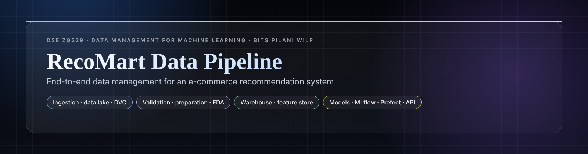
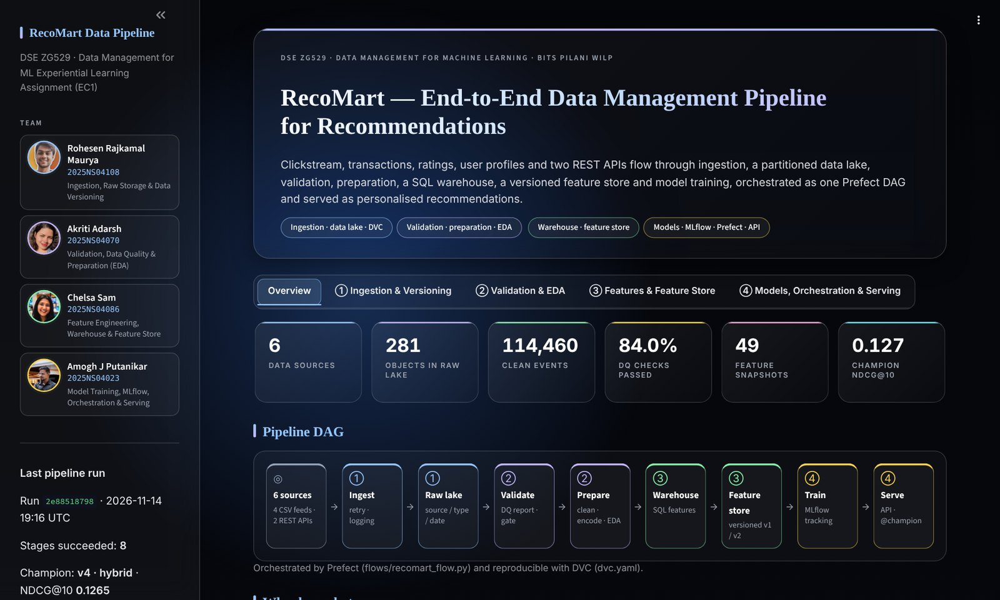
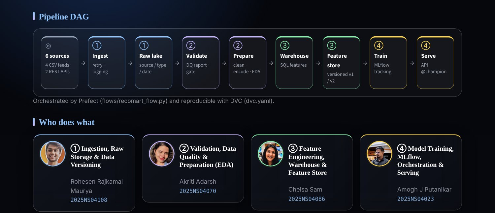
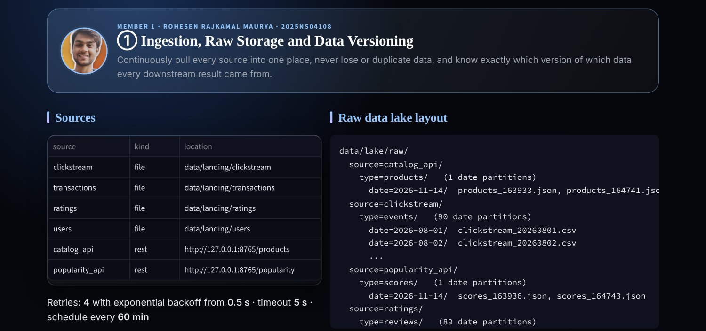
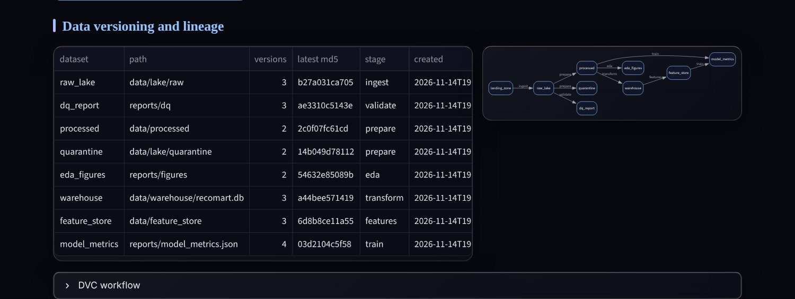
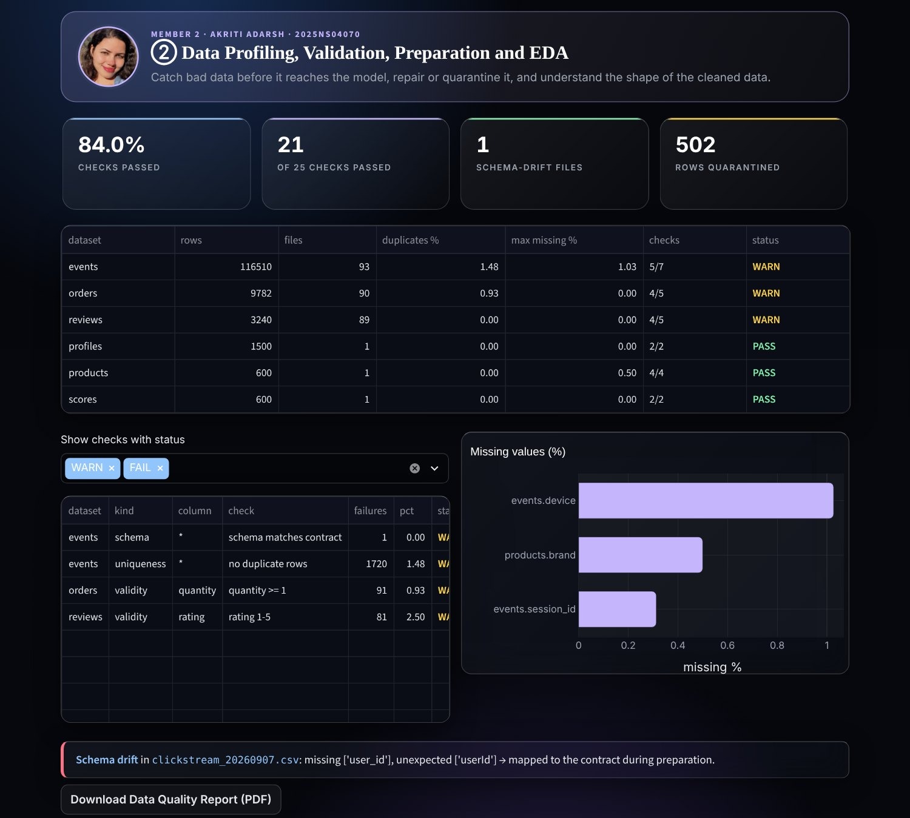
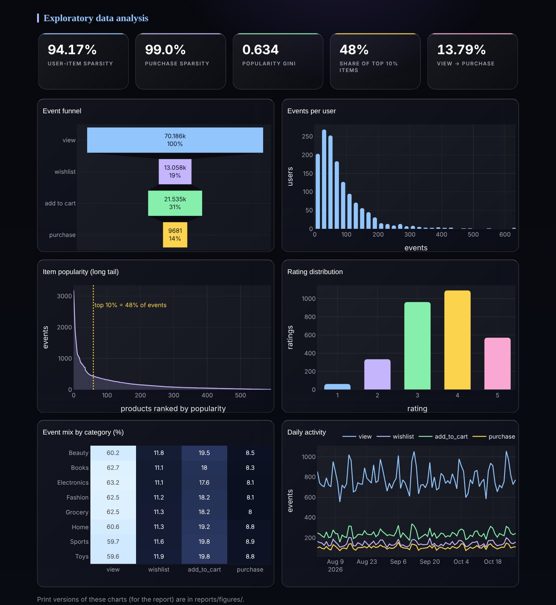
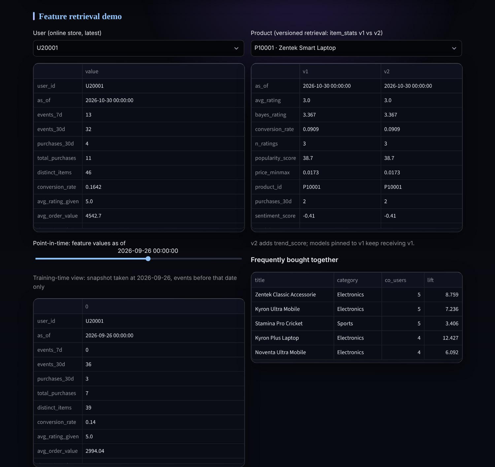
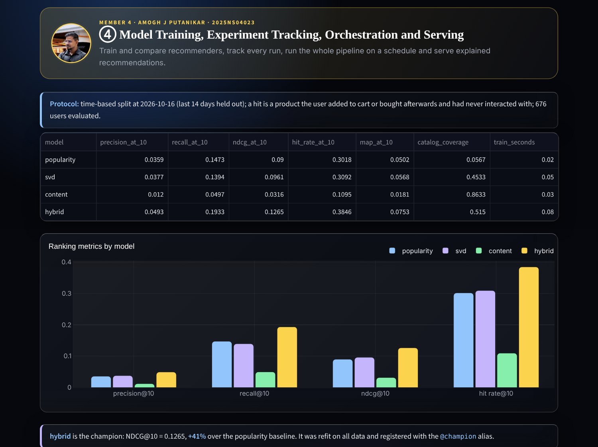
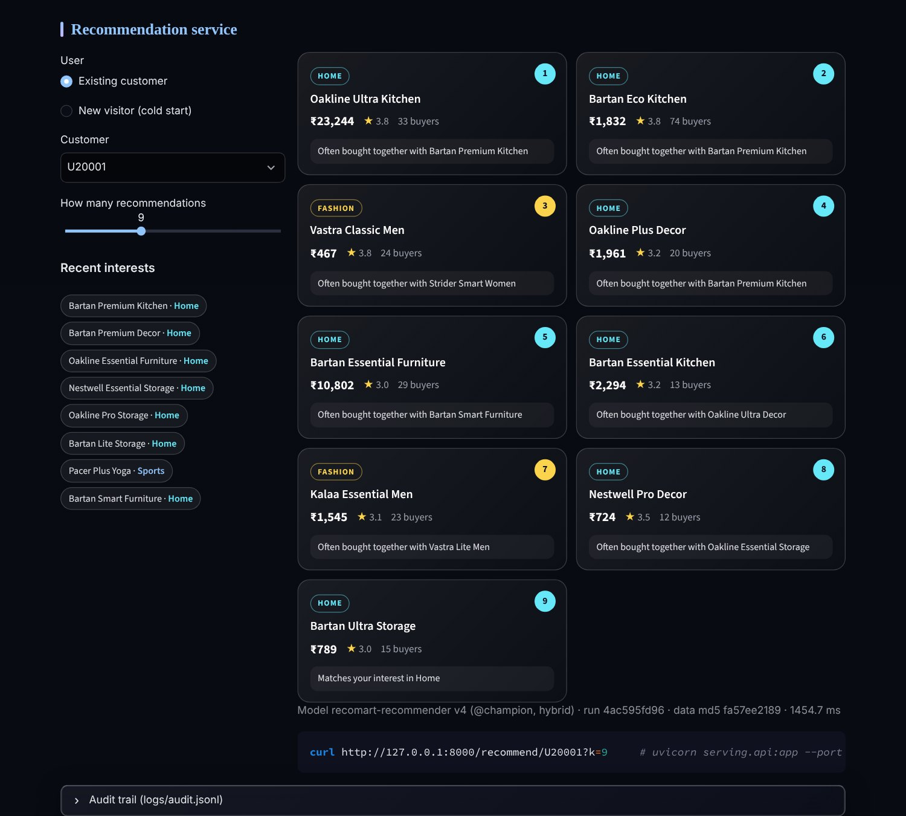

<p align="center">
  
</p>

<p align="center">
  <a href="https://recomart-data-pipeline.streamlit.app"></a>
  
  
  
  
  
</p>

<p align="center">
  <b>DSE ZG529 · Data Management for Machine Learning · BITS Pilani WILP</b><br>
  <a href="https://recomart-data-pipeline.streamlit.app">Live demo</a> ·
  <a href="#pipeline">Pipeline</a> ·
  <a href="#results">Results</a> ·
  <a href="#screenshots">Screenshots</a> ·
  <a href="#run-it">Run it</a>
</p>

---

RecoMart is an e-commerce start-up that wants personalised recommendations to raise conversion and cross-selling. This repository is the **complete data management pipeline** behind that engine: batch and near-real-time ingestion, a partitioned raw data lake, automated validation with a data quality report, preparation and EDA, SQL feature engineering in a warehouse, a versioned feature store, data versioning and lineage, model training tracked in MLflow, Prefect orchestration and a recommendation API.

<p align="center">
  
</p>

## Team

<table>
  <tr>
    <td align="center" width="25%"><br><b>Rohesen Rajkamal Maurya</b><br><code>2025NS04108</code><br><sub>① Ingestion, raw storage &amp; data versioning</sub></td>
    <td align="center" width="25%"><br><b>Akriti Adarsh</b><br><code>2025NS04070</code><br><sub>② Validation, data quality, preparation &amp; EDA</sub></td>
    <td align="center" width="25%"><br><b>Chelsa Sam</b><br><code>2025NS04086</code><br><sub>③ Feature engineering, warehouse &amp; feature store</sub></td>
    <td align="center" width="25%"><br><b>Amogh J Putanikar</b><br><code>2025NS04023</code><br><sub>④ Models, MLflow, orchestration &amp; serving</sub></td>
  </tr>
</table>

## Pipeline

<p align="center">
  
</p>

```
 clickstream CSV ─┐
 transactions CSV ┤                                   ┌─> EDA (figures, notebook)
 ratings CSV ─────┼─> ingest ─> raw lake ─> validate ─> prepare ─┤
 users CSV ───────┤   retry,    source/    pandera,    clean,     └─> transform ─> feature store ─> train ─> API
 catalog API ─────┤   logging   type/date  DQ report   encode,        SQL           versioned       MLflow   FastAPI
 popularity API ──┘                                    quarantine     warehouse     v1/v2           @champion
```

Orchestrated as a Prefect flow (`flows/recomart_flow.py`, scheduled hourly) and reproducible as a DVC pipeline (`dvc.yaml`).

| Task | Implementation | Evidence |
|---|---|---|
| Problem formulation | report, app "Overview" | business problem, sources, outputs, metrics |
| Data collection & ingestion | `src/recomart/ingestion.py`, `mock_api.py` | `logs/ingestion.log`, `logs/audit.jsonl` |
| Raw data storage | `src/recomart/storage.py`, `configs/storage.yaml` | `data/lake/raw/source=*/type=*/date=*`, [`docs/STORAGE.md`](docs/STORAGE.md) |
| Profiling & validation | `src/recomart/validation.py` (Pandera), `dq_report.py` | `reports/dq/data_quality_report.pdf` |
| Preparation & EDA | `src/recomart/preparation.py`, `eda.py`, [`notebooks/`](notebooks/01_data_preparation_and_eda.ipynb) | `reports/figures/*.png`, `data/processed/*.parquet` |
| Feature engineering | [`sql/schema.sql`](sql/schema.sql), `sql/features_*.sql`, `transform.py` | `data/warehouse/recomart.db` |
| Feature store | `src/recomart/feature_store.py` | `registry.yaml`, [`docs/FEATURES.md`](docs/FEATURES.md) |
| Versioning & lineage | `dvc.yaml`, `dvc.lock`, `lineage.py` | `data/lineage/datasets.json`, [`docs/VERSIONING.md`](docs/VERSIONING.md) |
| Training & evaluation | `models.py`, `evaluate.py`, `train.py` | MLflow runs, `reports/model_metrics.json` |
| Orchestration | `flows/recomart_flow.py`, `flows/serve.py` | Prefect UI, `logs/runs.jsonl`, `logs/alerts.log` |
| Serving | `serving/api.py`, `src/recomart/recommend.py` | `GET /recommend/{user_id}` |

## Results

Time-based holdout (last 14 days), K = 10, 676 evaluation users.

| Model | Precision@10 | Recall@10 | NDCG@10 | HitRate@10 | Coverage |
|---|---:|---:|---:|---:|---:|
| Popularity (baseline) | 0.036 | 0.147 | 0.090 | 0.302 | 0.06 |
| SVD matrix factorisation | 0.038 | 0.139 | 0.096 | 0.309 | 0.45 |
| Content-based (TF-IDF) | 0.012 | 0.050 | 0.032 | 0.110 | 0.86 |
| **Hybrid (SVD + co-occurrence + content)** | **0.049** | **0.193** | **0.127** | **0.385** | 0.52 |

The hybrid model improves NDCG@10 by about 40% over the popularity baseline and is registered in MLflow as `recomart-recommender@champion`. Data quality: 21 of 25 checks pass (84%); every warning is explained and handled in preparation.

## Screenshots

<table>
  <tr>
    <td width="50%"><b>① Ingestion and raw storage</b><br></td>
    <td width="50%"><b>① Lineage from source to model</b><br></td>
  </tr>
  <tr>
    <td><b>② Validation and data quality</b><br></td>
    <td><b>② Exploratory data analysis</b><br></td>
  </tr>
  <tr>
    <td><b>③ Feature store retrieval (online, point-in-time, versioned)</b><br></td>
    <td><b>④ Model comparison</b><br></td>
  </tr>
  <tr>
    <td colspan="2"><b>④ Recommendation service with explanations</b><br></td>
  </tr>
</table>

## Run it

```bash
pip install -r requirements-dev.txt && pip install -e .

python -m recomart.pipeline            # whole pipeline (or: python flows/recomart_flow.py)
pytest -q                              # 11 tests
streamlit run app.py                   # interactive walkthrough
uvicorn serving.api:app --port 8000    # API docs at http://127.0.0.1:8000/docs
mlflow ui --backend-store-uri sqlite:///mlflow.db
prefect server start                   # Prefect UI at http://127.0.0.1:4200
python flows/serve.py                  # scheduled deployment (every 60 minutes)
dvc repro                              # rebuild only what changed
```

Individual stages: `python -m recomart.pipeline --stage ingest|validate|prepare|eda|transform|features|train`.

## Data

The source systems are simulated (`src/recomart/generate.py`) with a fixed seed: 1,500 users, 600 products in 8 categories, about 116,000 clickstream events over 90 days, 9,800 orders and 3,200 ratings. Behaviour follows a latent-preference model, so the recommenders have a real signal to learn. Data-quality problems are injected on purpose (duplicates, missing values, an upstream column rename, invalid timestamps, out-of-range ratings, negative quantities and prices, unknown product IDs) so that validation and preparation can be demonstrated.

## Repository layout

```
configs/            pipeline.yaml (all parameters), storage.yaml (local / S3)
src/recomart/       generate, mock_api, ingestion, storage, validation, dq_report, preparation, eda,
                    transform, feature_store, lineage, models, evaluate, train, recommend, pipeline
sql/                schema.sql + feature transformations
flows/              Prefect flow and scheduled deployment
serving/            FastAPI recommendation service
notebooks/          data preparation and EDA notebook (executed)
tests/              pytest suite
docs/               STORAGE.md, VERSIONING.md, FEATURES.md
app.py              Streamlit walkthrough of every stage
dvc.yaml            DVC pipeline definition
```
